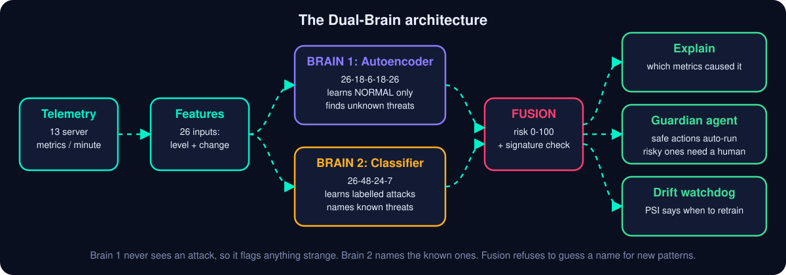

<p align="center">
  
</p>

<p align="center">
  <a href="https://github.com/AnyalstRushi/aegisnet-edge-ai/actions/workflows/ci.yml"></a>
  <a href="https://anyalstrushi.github.io/aegisnet-edge-ai/"></a>
  
  
  
  
  <a href="LICENSE"></a>
</p>

<p align="center">
  <a href="https://anyalstrushi.github.io/aegisnet-edge-ai/"><b>Live lab</b></a> &nbsp;|&nbsp;
  <a href="docs/PROJECT_REPORT.md"><b>Project report</b></a> &nbsp;|&nbsp;
  <a href="docs/ARCHITECTURE.md"><b>Architecture</b></a> &nbsp;|&nbsp;
  <a href="docs/DESIGN_DECISIONS.md"><b>Design decisions</b></a> &nbsp;|&nbsp;
  <a href="docs/USER_GUIDE.md"><b>User guide</b></a> &nbsp;|&nbsp;
  <a href="docs/VIVA_QA.md"><b>Viva Q&amp;A</b></a>
</p>

---

## Try it in 10 seconds: the AegisNet Lab

**[Open the live lab](https://anyalstrushi.github.io/aegisnet-edge-ai/)**. It trains a real autoencoder **inside your browser** in about 3 seconds (no server, no upload), then lets you attack the simulated server it protects. Launch a DDoS and watch the risk line spike, the network explain *which metrics* caused it, and the Guardian agent run the safe actions and **wait for you to approve the risky ones**. Tick *zero-day mode*, launch ransomware, and see the network refuse to give it a wrong name.

> The lab page is served by GitHub Pages. If the link shows a 404, the repository owner needs to switch Pages on once: **Settings > Pages > Deploy from a branch > `main` / `docs`**.

## Why this exists

By October 2026 the AI conversation has moved from "which giant model is best" to "what can we run in production, safely". Industry trackers report that most enterprises have tried AI agents but only a small share run them in production. Teams need models that are **small, private, explainable and governed**.

AegisNet applies that to IT security. It is a **34 KB neural network written from scratch in NumPy** that watches server telemetry and:

- detects **known and never-seen** attacks,
- tells the on-call engineer **why** it raised an alert,
- lets a **Guardian agent** run only safe actions itself and **ask a human** before risky ones,
- warns when live data has **drifted** and the model needs retraining.

No GPU. No API keys. No internet after `pip install`. All free tools.

<p align="center"></p>

<sub>Measured on 10 unseen days (14,400 minutes, 37 attack episodes) of simulated telemetry; reproduced by `python run_all.py`.</sub>

## How it works

<p align="center"></p>

| # | Idea | What it means |
|---|---|---|
| 1 | **Dual-Brain** | An unsupervised autoencoder and a supervised classifier are fused into one 0-100 risk score. |
| 2 | **Zero-day safety net** | An error-signature check sends never-seen patterns to `unknown_anomaly` instead of giving them a wrong name. |
| 3 | **Explains itself** | Every incident lists the metrics that caused it, with observed versus model-expected values. |
| 4 | **Guardian agent** | Bounded autonomy: safe actions auto-run, risky ones wait for a human, everything is audit-logged. |
| 5 | **Drift watchdog** | A Population Stability Index monitor says when to retrain. |
| 6 | **Edge-ready** | 34 KB and microseconds per window: fits a Raspberry Pi. |

### The zero-day experiment

Ransomware was removed from the classifier's training data and then shown at test time. A supervised classifier cannot recognise what it was never shown (here it silently called it normal). The autoencoder only needs to know what *normal* looks like.

<p align="center"></p>

### One simulated day

<p align="center"></p>

### What an incident looks like

Real output of `python run_all.py` (see [`docs/sample_incidents.txt`](docs/sample_incidents.txt)):

```text
[CRITICAL] Volumetric DDoS attack | minutes 92666-92694 (29 min) | peak risk 100/100
WHY: HTTP 5xx % = 13 (model expected ~2); Avg packet bytes = 463 (model expected ~595)
AUTO-EXECUTED : Enable CDN / WAF rate-limiting profile | Page the on-call network engineer
NEEDS HUMAN OK : Null-route top offending prefixes | Scale out replicas behind the load balancer
```

Guardian actions are **simulated** (audit-logged, not executed). Plug your own firewall or ticketing API into `Guardian.triage` in [`aegisnet/explain.py`](aegisnet/explain.py).

## Quick start

Python 3.10 or newer. New to this? Follow the [step-by-step user guide](docs/USER_GUIDE.md).

```bash
git clone https://github.com/AnyalstRushi/aegisnet-edge-ai.git
cd aegisnet-edge-ai
pip install -r requirements.txt

python run_all.py                          # ~15 s: simulate, train, evaluate, report
python -m unittest discover -s tests -v    # 12 automated tests
```

Open `outputs/report.html` for charts, metrics and incident reports. `python run_all.py --quick` is a 3-second smoke run.

### REST API

Run `python run_all.py` once first (it trains the model), then:

```bash
python api.py                              # http://127.0.0.1:5000
curl -s http://127.0.0.1:5000/health
curl -s -X POST http://127.0.0.1:5000/predict \
     -H "Content-Type: application/json" -d @sample_request.json
```

On Windows use `curl.exe`. `sample_request.json` holds the last 10 minutes of the 13 metrics, oldest first. The reply contains the risk score, the label and, for alerts, the explanation plus the Guardian plan.

### Use your own data

Build a DataFrame with `minute`, the 13 metrics below and `label` (`normal` or an attack name), then call `AegisNet().fit(normal_df, labeled_df)`.

`cpu_pct, mem_pct, disk_io_mbps, net_in_mbps, net_out_mbps, connections, failed_logins, unique_dst_ports, avg_pkt_bytes, dns_queries, http_5xx_pct, processes, file_writes`

For public datasets such as CICIDS2017 or NSL-KDD, write a loader that maps their columns onto these names (see [`aegisnet/data.py`](aegisnet/data.py)).

## Project structure

```text
AegisNet/
├── aegisnet/        nn.py (engine) | data.py (simulator) | models.py (Dual-Brain) | explain.py (XAI, Guardian, drift) | report.py
├── tests/           12 automated tests
├── docs/            index.html + lab.js (the live lab), report, architecture, design decisions, guides, viva Q&A
├── assets/          animated SVG banner, diagrams and charts
├── run_all.py       one-click pipeline and all experiments
├── api.py           Flask REST API
└── .github/         CI (Python 3.10, 3.11, 3.12), issue and pull-request templates
```

## Testing

`python -m unittest discover -s tests -v` runs 12 tests; CI runs them on Python 3.10, 3.11 and 3.12.

| Area | What is checked |
|---|---|
| Neural engine | gradient check against numerical gradients (MSE and cross-entropy), learns XOR |
| Data | deterministic simulator, valid columns and labels, no NaN features |
| Detection | AUC, recall and false-alarm limits, every attack family detected |
| Zero-day | unseen ransomware flagged and never mislabelled as a known attack |
| Explanation | the top metric of each incident matches the attack's real signature |
| Guardian | risky actions wait for approval and are audit-logged |
| Drift | stable data reads STABLE, shifted data reads DRIFT on the right metric |
| Production | save/load round trip, under 1 ms per window, REST API behaviour |

## Honest limitations

- **The data is simulated.** It keeps the project offline, reproducible and fully labelled, but real traffic is messier and real numbers will be lower. Validating on CICIDS2017 or production logs is the most important next step.
- **Guardian actions are simulated.** They are logged, not executed.
- **The browser lab is lighter than the Python project.** It runs Brain 1 plus nearest-signature naming and typically catches about 85-88% of attack minutes, versus 98.5% for the full Python system with its classifier.
- On known attacks the classifier alone ranks slightly higher (AUC 0.9999 vs 0.995 fused). The fused system trades a little ranking quality for the zero-day safety net.
- Port-scan naming is the weakest result (73% named correctly); most of the rest are still alerted as `unknown_anomaly`.

The reasoning behind each choice, including what it costs, is in [`docs/DESIGN_DECISIONS.md`](docs/DESIGN_DECISIONS.md).

## Roadmap

- [ ] Loaders for CICIDS2017 and NSL-KDD
- [ ] Local LLM (for example via Ollama) to write plain-language incident stories
- [ ] Real firewall and ticketing integrations for the Guardian
- [ ] ONNX export for edge devices
- [ ] Federated training across servers
- [ ] Classifier brain in the browser lab

## Author

**Rushi**, Analyst. GitHub: [@AnyalstRushi](https://github.com/AnyalstRushi)

Please cite via [`CITATION.cff`](CITATION.cff). Contributions are welcome, see [`CONTRIBUTING.md`](CONTRIBUTING.md). Released under the [MIT License](LICENSE).
