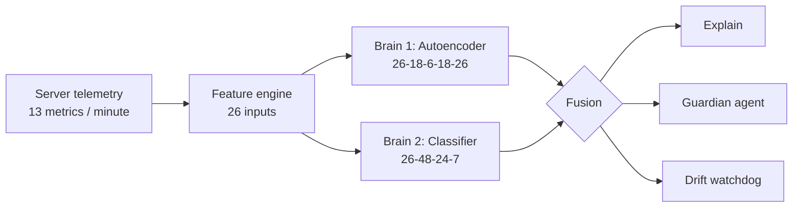
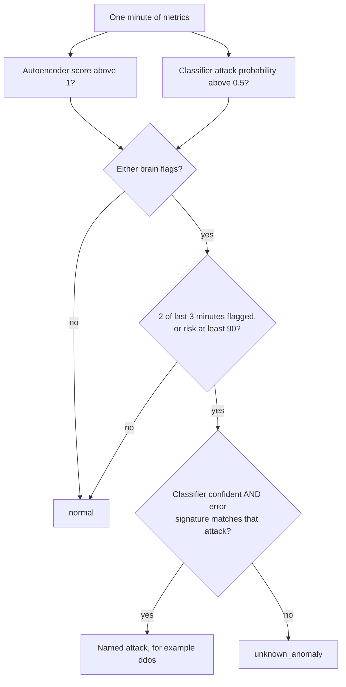
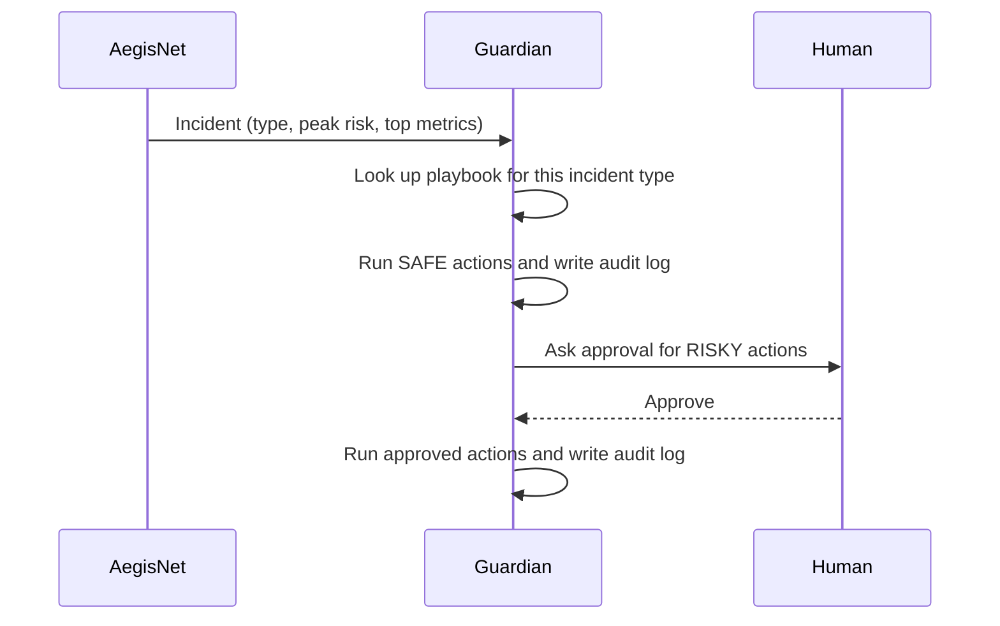

# AegisNet architecture

## 1. Big picture

| Stage | Code | Detail |
|---|---|---|
| Telemetry | `aegisnet/data.py` | 13 metrics per minute: CPU, memory, disk I/O, inbound and outbound traffic, connections, failed logins, unique ports, packet size, DNS queries, HTTP 5xx, processes, file writes |
| Features | `build_features()` | log(1+x) of each metric (13) plus its change versus the previous 5-minute average (13) = 26 inputs, standardised with normal-data statistics |
| Brain 1 | `models.py` | Autoencoder trained on normal data only. Score = reconstruction error / threshold (99.5th percentile of validation error) |
| Brain 2 | `models.py` | Softmax classifier over normal + 6 attack families, square-root class weights |
| Fusion | `AegisNet.analyze()` | Risk 0-100, persistence rule, signature check |
| Explain | `explain.py` | Share of reconstruction error per metric, observed versus model-expected values |
| Guardian | `explain.py` | Playbook of safe and human-approved actions, audit log |
| Drift | `explain.py` | Population Stability Index per metric |

## 2. Decision logic for one minute of data

**Risk score** = the larger of a sigmoid of the autoencoder score (50 at score 1) and 100 times the classifier's attack probability.

**Signature check.** During training the model stores, for each attack family, the average share of reconstruction error carried by each metric. At inference, the classifier's guess is accepted only if the current error pattern has a cosine similarity to that family's prototype above a threshold learned from training data (5th percentile, at least 0.5). This is what stops an unseen attack from being confidently mislabelled.

## 3. Guardian agent (bounded autonomy)

Safe actions: snapshots, tickets, paging, higher logging, rate-limit profiles. Risky actions: blocking IPs, isolating or quarantining hosts, killing processes. Actions are simulated in this repository.

## 4. Neural-network engine (`aegisnet/nn.py`)

- `Dense` layer: forward `z = xW + b` then tanh, ReLU or linear; manual backward pass.
- `MLP`: stack of layers, MSE loss (autoencoder) or softmax cross-entropy with class weights (classifier).
- Adam optimiser (beta1 0.9, beta2 0.999), weight decay, cosine learning-rate decay, He or Xavier initialisation.
- Correctness proven by a numerical gradient check in `tests/test_aegisnet.py`.

| Network | Layers | Parameters |
|---|---|---|
| Autoencoder | 26, 18, 6, 18, 26 (tanh, tanh, tanh, linear) | 1,220 |
| Classifier | 26, 48, 24, 7 (ReLU, ReLU, linear) | 2,647 |
| Total | | 3,867 (34 KB on disk) |

## 5. Extending it

- **Real data:** return a DataFrame with `minute`, the 13 metric columns and `label`.
- **More attack types:** add the label to the training data and `ATTACKS`, and a playbook entry in `PLAYBOOK`.
- **Real actions:** replace the audit-log write in `Guardian.triage` with your firewall or ticketing call.
